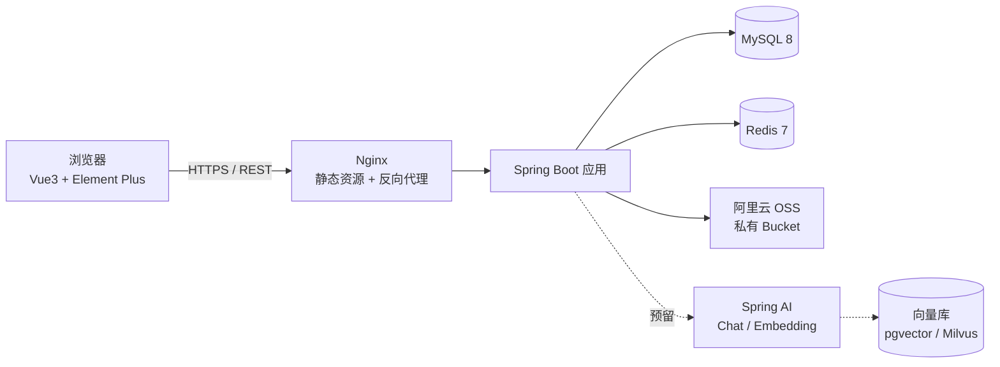
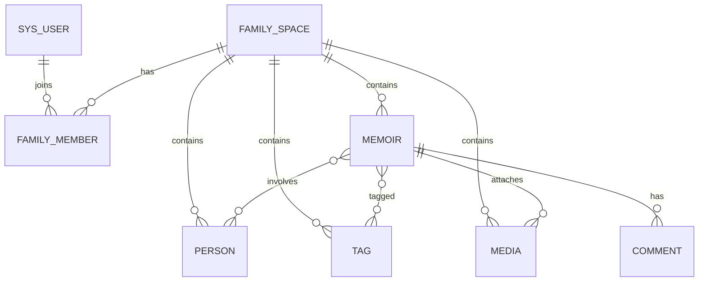

# 家庭回忆录系统 · 设计说明文档

| 项 | 内容 |
| --- | --- |
| 文档版本 | v0.1（初稿，待评审） |
| 编写日期 | 2026-11-07 |
| 项目代号 | Family Memoir |
| 技术栈 | Vue 3 + Element Plus / Spring Boot 3 |
| 当前阶段 | 一期：不含 AI 能力，但预留 Spring AI 扩展点 |

---

## 1. 项目概述

### 1.1 背景

家庭中的照片、故事、长辈口述、重要日子，通常散落在多个手机相册、聊天记录和纸质相册里，时间一长就难以查找，也难以传承。本系统面向家庭内部，提供一个**私密、长期、可持续积累**的家庭回忆录空间。

### 1.2 目标

- 把「一件事」记录成一条完整的回忆：文字 + 照片/视频/音频 + 时间 + 地点 + 涉及的人。
- 以时间轴为主线，回看家庭的历史脉络。
- 支持按人物、年份、标签、关键字快速检索。
- 支持一键导出成册（PDF / 图文长页），便于打印或分享给长辈。
- 为后期 AI 能力（语义检索、自动撰写、老照片理解、家族问答）预留清晰接入点。

### 1.3 目标用户与角色

| 角色 | 说明 | 权限 |
| --- | --- | --- |
| 空间所有者 Owner | 创建家庭空间的人 | 全部权限，含解散空间、转让 |
| 管理员 Admin | 家庭中被授权的成员 | 成员管理、内容管理、审核 |
| 编辑者 Editor | 普通家庭成员 | 增删改自己的回忆、上传媒体、评论 |
| 浏览者 Viewer | 长辈或只读成员 | 只读、评论（可配置开关） |

> 一名用户可同时加入多个家庭空间（如「我家」与「外婆家」），数据严格按空间隔离。

### 1.4 非目标（一期不做）

- 不做社交广场、公开社区、陌生人访问。
- 不做家族树可视化编辑（二期考虑）。
- 不做移动端 App / 小程序（一期为响应式 Web）。
- 不接入支付、会员体系。

---

## 2. 技术选型

### 2.1 前端

| 类别 | 选型 | 说明 |
| --- | --- | --- |
| 框架 | Vue 3.4+（Composition API + `<script setup>`） | 与 Element Plus 生态一致 |
| 构建 | Vite 5 | 本地启动快，配置简单 |
| 语言 | TypeScript | 接口与实体类型可复用 |
| UI | Element Plus 2.8+ | 表格、表单、上传、日期选择器开箱可用 |
| 状态 | Pinia + pinia-plugin-persistedstate | 仅持久化 token 与少量偏好 |
| 路由 | Vue Router 4 | 路由守卫控制登录态与角色 |
| 请求 | Axios（统一封装拦截器） | 统一错误提示、token 注入、取消重复请求 |
| 富文本 | WangEditor 5 或 TipTap | 建议 WangEditor，中文文档完善、体积可控 |
| 图片处理 | vue-cropper + 浏览器端压缩 | 上传前压缩，降低存储成本 |
| 图表（可选） | ECharts | 统计页：年份分布、人物出镜次数 |
| 代码规范 | ESLint + Prettier + Stylelint + Husky | 统一提交规范 |

### 2.2 后端

| 类别 | 选型 | 说明 |
| --- | --- | --- |
| 运行时 | JDK 17 | Spring Boot 3 最低要求 |
| 框架 | Spring Boot 3.3.x | Web、Validation、Actuator |
| 持久层 | MyBatis-Plus 3.5.x | CRUD 便捷，复杂查询写 XML |
| 数据库 | MySQL 8.0（utf8mb4） | 主库 |
| 缓存 | Redis 7 | 登录态、验证码、热点数据、限流 |
| 鉴权 | Spring Security + JWT（Access + Refresh） | 无状态，便于横向扩展 |
| 文件存储 | 阿里云 OSS | 私有 Bucket + 预签名直传，服务端中转小文件 |
| 接口文档 | SpringDoc OpenAPI 3 | 生成 Swagger UI |
| 参数校验 | Jakarta Validation | DTO 上使用注解 |
| 对象映射 | MapStruct | Entity / DTO / VO 转换 |
| 日志 | Logback + MDC traceId | 请求链路追踪 |
| 部署 | Docker Compose + Nginx | 前端静态资源由 Nginx 托管 |

### 2.3 选型说明

- **不用 Spring Data JPA**：回忆录有大量时间轴、标签、全文检索类查询，MyBatis-Plus + 手写 SQL 更可控。
- **不用 Sa-Token**：功能虽更轻，但后期接入 Spring AI 与 OAuth/第三方登录时 Spring Security 生态更完整。
- **数据库不引入 Elasticsearch**：一期数据量在家庭级别（万级条目以内），MySQL 全文索引 + 组合查询足够；二期再引入 ES 或向量库。
- **存储固定使用阿里云 OSS**：Bucket 设为私有读，前端通过后端签发的短期签名 URL 访问；不使用 MinIO，本地开发也连同一个 OSS Bucket（通过 `family.oss.enabled=false` 可在无凭证时跳过上传）。

---

## 3. 系统架构



### 3.1 分层约定

- **Controller**：只做参数接收、校验、权限注解、调用 Service，不写业务逻辑。
- **Service**：业务编排与事务边界；跨模块调用走 Service 接口，不直接调 Mapper。
- **Mapper**：单表 CRUD 用 MyBatis-Plus，多表联查写 XML。
- **DTO / VO 分离**：入参 DTO 带校验注解，出参 VO 不带敏感字段（如密码、内部状态）。
- **统一异常**：业务异常抛 `BizException(code, message)`，由全局异常处理器转换为统一响应。

### 3.2 统一响应与错误码

```json
{
  "code": 0,
  "message": "ok",
  "data": {},
  "traceId": "a1b2c3d4"
}
```

| 区间 | 含义 |
| --- | --- |
| 0 | 成功 |
| 1xxxx | 通用错误（参数、鉴权、限流） |
| 2xxxx | 用户与空间 |
| 3xxxx | 回忆录与媒体 |
| 4xxxx | 导出与 AI |
| 5xxxx | 系统与第三方依赖 |

分页统一返回：`{ records, total, page, size }`，入参统一 `page`（从 1 开始）、`size`（默认 10，上限 100）。

---

## 4. 功能模块设计

### 4.1 模块总览

| 模块 | 优先级 | 说明 |
| --- | --- | --- |
| 账号与鉴权 | P0 | 注册、登录、刷新令牌、个人信息 |
| 家庭空间 | P0 | 创建/加入/切换空间、邀请码、成员角色 |
| 回忆录 | P0 | 新建、编辑、删除、草稿、发布、富文本、封面上传 |
| 时间轴 | P0 | 按年月聚合展示，支持筛选 |
| 媒体库 | P0 | 图片/视频/音频上传、相册视图、引用关系 |
| 人物档案 | P1 | 家庭成员档案，与回忆关联 |
| 标签与检索 | P1 | 标签管理、关键字搜索、组合筛选 |
| 评论互动 | P2 | 评论、表情回应（默认关闭） |
| 纪念日提醒 | P2 | 生日、忌日、结婚纪念日，站内提醒 |
| 导出成册 | P1 | 按时间/标签/人物生成 PDF |
| 数据统计 | P2 | 年份分布、人物出现频次、媒体数量 |
| AI 能力 | 二期 | 见第 9 章 |

### 4.2 核心流程：一条回忆的诞生

1. 用户在空间内点击「写回忆」。
2. 填写标题、正文（富文本），插入图片（自动上传到媒体库并回填 URL）。
3. 选择时间（支持只填年份或年月，如「1985 年夏天」→ 存 `event_year=1985` 与 `event_precision=YEAR`）。
4. 选择地点（文本 + 可选坐标）、选择涉及的人物、打标签。
5. 设置可见范围（空间内公开 / 仅自己）。
6. 保存草稿或发布。
7. 发布后自动进入时间轴，并按需生成异步任务（如 AI 摘要，二期）。

### 4.3 时间精度设计

家庭回忆常出现「大概 1985 年」「九十年代」「春节前后」这类模糊时间，不能只用 `datetime`：

| 字段 | 说明 |
| --- | --- |
| `event_time` | 精确时间（可空） |
| `event_year` / `event_month` / `event_day` | 拆分冗余字段，便于排序与筛选 |
| `event_precision` | `YEAR` / `MONTH` / `DAY` / `EXACT` / `UNKNOWN` |
| `event_time_text` | 展示用原文，如「1985 年夏天」「大约在七十年代末」 |

时间轴排序规则：优先 `event_time`，其次 `event_year`、`event_month`，未知时间单独归入「未定时间」分组。

---

## 5. 数据模型

### 5.1 实体关系



### 5.2 表结构（一期）

#### sys_user 用户

| 字段 | 类型 | 说明 |
| --- | --- | --- |
| id | bigint PK | 雪花 ID |
| username | varchar(50) | 唯一 |
| password_hash | varchar(100) | BCrypt |
| nickname | varchar(50) | 昵称 |
| avatar_url | varchar(500) | 头像 |
| email / phone | varchar(100) | 可空，用于找回 |
| status | tinyint | 0 禁用 / 1 正常 |
| created_at / updated_at | datetime | 审计字段 |

#### family_space 家庭空间

| 字段 | 类型 | 说明 |
| --- | --- | --- |
| id | bigint PK | |
| name | varchar(100) | 空间名，如「我们这一家」 |
| cover_url | varchar(500) | 封面 |
| description | varchar(500) | 简介 |
| owner_id | bigint | 所有者 |
| invite_code | varchar(20) | 邀请码，可重置 |
| member_limit | int | 成员上限（默认 20） |
| created_at / updated_at | datetime | |

#### family_member 空间成员

| 字段 | 类型 | 说明 |
| --- | --- | --- |
| id | bigint PK | |
| space_id | bigint | 空间 |
| user_id | bigint | 用户 |
| role | varchar(20) | OWNER / ADMIN / EDITOR / VIEWER |
| relation | varchar(30) | 家庭称谓，如「妈妈」「三舅」 |
| joined_at | datetime | |

唯一索引：`(space_id, user_id)`。

#### person 人物档案

| 字段 | 类型 | 说明 |
| --- | --- | --- |
| id | bigint PK | |
| space_id | bigint | |
| name | varchar(50) | 姓名/称呼 |
| relation | varchar(30) | 与家庭的称谓 |
| gender | tinyint | 0 未知 / 1 男 / 2 女 |
| birth_date / death_date | date | 可空，仅到年时用 `date_precision` 标记 |
| date_precision | varchar(10) | YEAR / MONTH / DAY |
| avatar_url | varchar(500) | |
| bio | text | 简介、口述整理 |
| is_alive | tinyint | 1 在世 / 0 已故 |
| created_at / updated_at | datetime | |

#### memoir 回忆录条目

| 字段 | 类型 | 说明 |
| --- | --- | --- |
| id | bigint PK | |
| space_id | bigint | 空间 |
| title | varchar(200) | 标题 |
| summary | varchar(500) | 摘要（列表展示；二期可由 AI 生成） |
| content | longtext | 富文本 HTML（后端做白名单过滤） |
| content_text | text | 纯文本冗余，供全文检索 |
| cover_media_id | bigint | 封面媒体 |
| event_time | datetime | 可空 |
| event_year / event_month / event_day | int | 冗余，便于筛选 |
| event_precision | varchar(10) | 时间精度 |
| event_time_text | varchar(100) | 原文表达 |
| location_name | varchar(200) | 地点文本 |
| longitude / latitude | decimal(10,6) | 可空 |
| mood | varchar(20) | 情绪标签（可选） |
| privacy | varchar(20) | SPACE / PRIVATE |
| author_id | bigint | 作者 |
| status | varchar(20) | DRAFT / PUBLISHED |
| view_count | int | 浏览量 |
| created_at / updated_at / deleted | datetime / tinyint | 逻辑删除 |

索引建议：`(space_id, status, event_year, event_month)`、`(space_id, author_id)`、`content_text` 全文索引（ngram）。

#### memoir_person / memoir_tag 关联表

`(memoir_id, person_id)`、`(memoir_id, tag_id)`，均为联合唯一索引。

#### media 媒体

| 字段 | 类型 | 说明 |
| --- | --- | --- |
| id | bigint PK | |
| space_id | bigint | |
| memoir_id | bigint | 可空（也可先上传到媒体库再引用） |
| type | varchar(10) | IMAGE / VIDEO / AUDIO |
| storage_key | varchar(500) | 对象存储 key |
| url / thumb_url | varchar(500) | 展示地址（签名 URL 动态生成） |
| mime_type | varchar(100) | |
| size | bigint | 字节 |
| width / height / duration | int | 元信息 |
| exif_time | datetime | 拍摄时间（图片 EXIF，用于「按拍摄时间归档」） |
| uploaded_by | bigint | |
| created_at | datetime | |

#### tag

`id, space_id, name, color, created_at`，唯一索引 `(space_id, name)`。

#### comment（P2）

`id, memoir_id, user_id, content, parent_id, created_at, deleted`。

#### anniversary（P2）

`id, space_id, title, date, date_precision, repeat_type(YEARLY/NONE), related_person_id, remind_days_before, enabled`。

#### export_task（P1）

`id, space_id, type(PDF/LONG_PAGE), params_json, status(PENDING/RUNNING/SUCCESS/FAILED), file_url, error_msg, created_by, created_at, finished_at`。

#### ai_embedding（二期预留，建表但不启用）

`id, space_id, source_type(MEMOIR/PERSON/MEDIA), source_id, chunk_index, chunk_text, embedding_model, vector_id, updated_at`。

#### operation_log（P1）

`id, space_id, user_id, action, target_type, target_id, detail_json, ip, created_at`。

### 5.3 数据隔离原则

- 所有业务表带 `space_id`，Service 层入口统一校验「当前用户是否属于该空间」。
- 查询一律附加 `space_id` 条件，禁止依赖前端传参做数据边界。
- 私有回忆（`privacy=PRIVATE`）仅作者与 Owner 可见。

---

## 6. 接口设计

### 6.1 规范

- 前缀 `/api/v1`，RESTful 风格，资源名复数。
- 鉴权头：`Authorization: Bearer <accessToken>`。
- 时间格式统一 `yyyy-MM-dd HH:mm:ss`，日期 `yyyy-MM-dd`，时区 `Asia/Shanghai`。
- 所有写接口做幂等或防重复提交（前端按钮 loading + 后端唯一约束兜底）。
- 接口文档通过 SpringDoc 自动生成，`/swagger-ui.html` 仅在内网/开发环境开放。

### 6.2 接口清单（一期）

#### 认证

| 方法 | 路径 | 说明 |
| --- | --- | --- |
| POST | `/auth/register` | 注册 |
| POST | `/auth/login` | 登录，返回 access/refresh token |
| POST | `/auth/refresh` | 刷新令牌 |
| POST | `/auth/logout` | 退出（令牌加入 Redis 黑名单） |
| GET | `/auth/me` | 当前用户信息与所属空间列表 |

#### 家庭空间

| 方法 | 路径 | 说明 |
| --- | --- | --- |
| POST | `/spaces` | 创建空间 |
| GET | `/spaces` | 我的空间列表 |
| GET | `/spaces/{spaceId}` | 空间详情 |
| PUT | `/spaces/{spaceId}` | 修改（Owner/Admin） |
| POST | `/spaces/join` | 凭邀请码加入 |
| POST | `/spaces/{spaceId}/invite-code/reset` | 重置邀请码 |
| GET | `/spaces/{spaceId}/members` | 成员列表 |
| PUT | `/spaces/{spaceId}/members/{userId}/role` | 调整角色 |
| DELETE | `/spaces/{spaceId}/members/{userId}` | 移除成员 |

#### 回忆录

| 方法 | 路径 | 说明 |
| --- | --- | --- |
| POST | `/spaces/{spaceId}/memoirs` | 新建（草稿或直接发布） |
| GET | `/spaces/{spaceId}/memoirs` | 分页列表，支持 `keyword/year/tagId/personId/status` |
| GET | `/spaces/{spaceId}/memoirs/timeline` | 时间轴聚合（按年月分组） |
| GET | `/spaces/{spaceId}/memoirs/{id}` | 详情（含媒体、人物、标签） |
| PUT | `/spaces/{spaceId}/memoirs/{id}` | 修改 |
| PATCH | `/spaces/{spaceId}/memoirs/{id}/status` | 发布 / 撤回草稿 |
| DELETE | `/spaces/{spaceId}/memoirs/{id}` | 逻辑删除 |
| GET | `/spaces/{spaceId}/memoirs/search` | 全文检索（标题 + 正文 + 摘要） |

#### 媒体

| 方法 | 路径 | 说明 |
| --- | --- | --- |
| POST | `/spaces/{spaceId}/media/presign` | 获取直传预签名（大文件） |
| POST | `/spaces/{spaceId}/media/upload` | 服务端中转上传（小文件） |
| GET | `/spaces/{spaceId}/media` | 媒体库分页，支持类型/年月筛选 |
| DELETE | `/spaces/{spaceId}/media/{id}` | 删除（校验引用关系） |

#### 人物 / 标签

| 方法 | 路径 | 说明 |
| --- | --- | --- |
| CRUD | `/spaces/{spaceId}/persons` | 人物档案 |
| GET | `/spaces/{spaceId}/persons/{id}/memoirs` | 该人物相关回忆 |
| CRUD | `/spaces/{spaceId}/tags` | 标签 |

#### 导出

| 方法 | 路径 | 说明 |
| --- | --- | --- |
| POST | `/spaces/{spaceId}/exports` | 创建导出任务，参数：范围（全部/年份/标签/人物）、排序、是否含水印 |
| GET | `/spaces/{spaceId}/exports/{id}` | 查询任务状态与下载地址 |

### 6.3 关键接口示例

创建回忆：

```json
POST /api/v1/spaces/1001/memoirs
{
  "title": "外婆家的夏天",
  "content": "<p>院子里那棵石榴树...</p>",
  "summary": "",
  "eventTimeText": "1985 年夏天",
  "eventYear": 1985,
  "eventPrecision": "YEAR",
  "locationName": "浙江·绍兴",
  "personIds": [12, 13],
  "tagIds": [3, 5],
  "mediaIds": [201, 202],
  "privacy": "SPACE",
  "status": "PUBLISHED"
}
```

时间轴返回：

```json
{
  "code": 0,
  "data": {
    "groups": [
      {
        "year": 1985,
        "count": 12,
        "items": [
          { "id": 88, "title": "外婆家的夏天", "coverUrl": "...", "eventTimeText": "1985 年夏天", "personNames": ["外婆", "母亲"] }
        ]
      }
    ],
    "unknownGroup": { "count": 3, "items": [] }
  }
}
```

---

## 7. 前端设计

### 7.1 目录结构

```
frontend/
├── src/
│   ├── api/                # 按模块拆分：auth.ts, space.ts, memoir.ts, media.ts...
│   ├── assets/
│   ├── components/         # 通用组件：MediaUploader, PersonSelect, TagSelect, TimePicker...
│   ├── composables/        # useSpace, usePermission, useUpload, usePagination
│   ├── layouts/            # 主布局、空间切换
│   ├── router/             # 路由表 + 守卫
│   ├── stores/             # user, space, app
│   ├── styles/             # 变量、reset、主题
│   ├── types/              # 接口类型定义
│   ├── utils/              # request.ts, auth.ts, format.ts, validate.ts
│   └── views/              # 页面
├── .env.development
├── .env.production
└── vite.config.ts
```

### 7.2 页面清单

| 页面 | 路径 | 说明 |
| --- | --- | --- |
| 登录 / 注册 | `/login` | 表单校验、记住我 |
| 空间选择 | `/spaces` | 卡片列表 + 创建/加入 |
| 首页 | `/s/:spaceId/home` | 最近更新、纪念日、快捷入口 |
| 时间轴 | `/s/:spaceId/timeline` | 纵向时间轴，年月折叠，懒加载 |
| 回忆列表 | `/s/:spaceId/memoirs` | 卡片/列表切换、筛选面板 |
| 回忆详情 | `/s/:spaceId/memoirs/:id` | 图文详情、媒体灯箱、人物标签 |
| 回忆编辑 | `/s/:spaceId/memoirs/edit/:id?` | 富文本 + 侧边信息栏，自动保存草稿 |
| 媒体库 | `/s/:spaceId/media` | 瀑布流相册、按年月分组 |
| 人物档案 | `/s/:spaceId/persons` | 人物卡片 + 详情抽屉 |
| 搜索 | `/s/:spaceId/search` | 关键字 + 筛选条件组合 |
| 导出 | `/s/:spaceId/export` | 范围选择、进度轮询、下载 |
| 空间设置 | `/s/:spaceId/settings` | 基本信息、成员与角色、邀请码 |
| 个人中心 | `/profile` | 资料、密码、所属空间 |

### 7.3 关键前端约定

- **权限控制**：`usePermission()` 根据当前空间角色返回 `canEdit / canManage / canView`；按钮级用 `v-permission` 指令；路由级用 meta 校验。
- **请求封装**：`request.ts` 统一注入 token；401 自动用 refresh token 重试一次，失败跳登录；错误码映射为中文提示。
- **上传**：大图先压缩（长边 ≤ 2000px，质量 0.85），再走预签名直传；上传中显示进度与失败重试。
- **草稿自动保存**：编辑页每 30 秒或失焦时保存，`status=DRAFT`，避免长辈误操作丢失内容。
- **空状态与引导**：首次进入空间展示「写第一条回忆」引导，降低使用门槛。
- **适老化**：字号可切换「标准/大」，关键操作按钮不小于 44px 点击区。

---

## 8. 后端设计

### 8.1 目录结构

```
backend/
├── src/main/java/com/family/memoir/
│   ├── FamilyMemoirApplication.java
│   ├── common/
│   │   ├── result/         # Result, PageResult
│   │   ├── exception/      # BizException, GlobalExceptionHandler, ErrorCode
│   │   ├── constant/
│   │   └── util/
│   ├── config/             # SecurityConfig, MybatisPlusConfig, RedisConfig, OssConfig, WebMvcConfig
│   ├── auth/               # JwtProvider, JwtFilter, UserContext, LoginService
│   ├── module/
│   │   ├── user/           # controller / service / mapper / entity / dto / vo
│   │   ├── space/
│   │   ├── memoir/
│   │   ├── media/
│   │   ├── person/
│   │   ├── tag/
│   │   ├── comment/
│   │   ├── anniversary/
│   │   ├── export/
│   │   └── ai/             # 二期，一期仅有接口与空实现
│   └── infra/              # 存储、消息、异步任务、限流
└── src/main/resources/
    ├── application.yml
    ├── application-dev.yml
    ├── application-prod.yml
    └── mapper/             # XML
```

### 8.2 关键实现要点

1. **鉴权链路**：`JwtFilter` 解析 token → 放入 `UserContext`（ThreadLocal）→ 拦截器校验空间归属 → 清理上下文（`finally`）。
2. **空间权限校验**：自定义注解 `@RequireSpaceRole({OWNER, ADMIN})` + AOP 切面，从路径变量取 `spaceId`，查 Redis 缓存的成员角色（5 分钟过期，变更时主动失效）。
3. **富文本安全**：入库前用 OWASP Java HTML Sanitizer 做标签白名单过滤，防止 XSS；出参不再二次转义。
4. **逻辑删除**：MyBatis-Plus `@TableLogic`，删除回忆时保留关联媒体，媒体真正删除需无引用。
5. **文件访问**：OSS Bucket 私有读，不暴露公网地址；前端通过 `/api/v1/storage/signed-url` 获取短期签名 URL，或在 `/api/v1/media/{id}/raw?sign=...` 中转下载，防止链接外传。
6. **事务**：仅写操作加 `@Transactional(rollbackFor = Exception.class)`，读接口不加。
7. **异步**：导出、缩略图生成、AI 任务走 `@Async` + 任务表状态机，避免请求阻塞。
8. **限流**：登录、上传、导出接口用 Redis 滑动窗口限流。
9. **审计**：关键写操作（删除、改权限、导出）记 `operation_log`。

### 8.3 导出实现方案

- PDF：服务端用模板引擎（Thymeleaf / Freemarker）渲染 HTML，再经 `openhtmltopdf` 或 Playwright 无头浏览器转 PDF。
- 长图/HTML：直接生成自包含 HTML 文件，便于微信内分享（二期）。
- 图片统一转 WebP 或压缩后嵌入，控制 PDF 体积。

---

## 9. 二期：Spring AI 扩展设计

一期不开工，但结构上预留，避免后期大改。

### 9.1 预留方式

- 定义 `AiService` 接口（`summarize`、`semanticSearch`、`describeMedia`、`chat`），一期提供 `NoopAiServiceImpl` 返回「功能未启用」。
- 依赖与配置默认关闭：`family.ai.enabled=false`，AI 相关 Bean 用 `@ConditionalOnProperty` 装配。
- 数据库预留 `ai_embedding` 表，媒体表预留 `ai_caption` 字段（可后加）。
- 异步任务表预留 `task_type=AI_SUMMARY` 等枚举值。

### 9.2 规划中的 AI 场景

| 场景 | 说明 | 依赖 |
| --- | --- | --- |
| 回忆摘要生成 | 长文自动生成 1-2 句摘要，用于卡片展示 | Chat Model |
| 语义检索 | 「外婆做的那道菜」可搜到未含关键词的回忆 | Embedding + 向量库 |
| 老照片描述 | 识别照片场景、人物、年代，生成描述与标签建议 | 多模态模型 |
| 口述转文字 | 长辈语音转文字并结构化 | 语音转写 |
| 家族问答 | 基于全家回忆做 RAG 问答 | Embedding + Chat |
| 时间线补全 | 从零散记录推断家族事件顺序，提示缺失年份 | Chat Model |

### 9.3 接入注意

- **成本控制**：仅对新增/修改内容增量向量化；批量任务限速；记录 token 用量。
- **隐私**：调用外部模型前明确告知用户；提供「禁止上传到第三方模型」的空间级开关；传输内容做脱敏（去除手机号、住址）。
- **可替换**：通过 Spring AI 的 `ChatClient` / `EmbeddingModel` 抽象，模型供应商可通过配置切换，不写死在业务代码里。
- **向量库**：家庭级数据量小，优先 `pgvector`（与 MySQL 并存）或 `Milvus Lite`，避免引入重型组件。

---

## 10. 非功能需求

### 10.1 安全与隐私

- 全站 HTTPS；密码 BCrypt 加盐；JWT 有效期 Access 2 小时、Refresh 7 天。
- 家庭数据默认不公开、不被搜索引擎索引（`X-Robots-Tag: noindex`）。
- 媒体访问使用短期签名 URL，禁止目录遍历。
- 邀请码可重置、可设置有效期；成员移除后立即失效其空间访问。
- 定期备份：MySQL 每日全量 + binlog；OSS 开启同城/跨区域复制，并定期拉取到本地冷备。
- 敏感操作二次确认（删除回忆、移除成员、解散空间）。

### 10.2 性能

| 指标 | 目标 |
| --- | --- |
| 首屏加载 | < 2s（内网/常规宽带） |
| 列表接口 P95 | < 300ms（10 万条回忆以内） |
| 图片加载 | 缩略图 < 100KB，详情图按需加载 |
| 并发 | 单家庭 20 人规模，整体支持 500 并发读 |

优化手段：时间轴分页 + 懒加载、封面缩略图、列表不返回正文、Redis 缓存空间信息与标签、图片 CDN/对象存储直出。

### 10.3 可用性与兼容

- 支持 Chrome/Edge/Safari 最近两个大版本，移动端 Safari/微信内置浏览器。
- 响应式断点：≥1200 桌面、768–1199 平板、<768 手机。
- 关键操作有明确 loading、成功/失败反馈与重试入口。

---

## 11. 开发里程碑

| 阶段 | 内容 | 交付物 |
| --- | --- | --- |
| M0 脚手架 | 前后端工程初始化、统一响应、异常、日志、Swagger、Docker Compose（MySQL/Redis/MinIO） | 可跑通的前后端骨架 |
| M1 账号与空间 | 注册登录、JWT、空间创建/加入、成员与角色 | 登录后可进入空间 |
| M2 回忆录核心 | 回忆 CRUD、富文本、媒体上传、草稿/发布 | 可完整记录一条回忆 |
| M3 组织与检索 | 时间轴、标签、人物、全文检索 | 可回看与查找 |
| M4 媒体与导出 | 相册视图、PDF 导出、导出任务 | 可导出成册 |
| M5 打磨 | 权限细化、审计日志、限流、适老化、性能优化 | 可交付内测 |
| M6 AI（二期） | Spring AI 接入、语义检索、摘要生成 | 按需启动 |

每个阶段结束做一次联调与自测清单，验收后再进入下一阶段。

---

## 12. 待确认问题

以下问题会影响表结构与接口设计，建议评审时确认：

1. **是否需要多空间**？一期是否只允许一个家庭空间？（当前设计按多空间，成本略高但扩展性好）
2. **是否需要公开分享**？例如生成只读链接发给没有账号的亲戚。
3. **部署环境**：公网云服务器还是家庭 NAS/内网？直接影响对象存储与 HTTPS 方案。
4. **导出形式**：PDF 打印版优先，还是 HTML 长页便于微信分享？
5. **人物档案范围**：只记录称谓，还是需要完整家族树与亲属关系推导？
6. **是否需要语音口述**：一期是否支持录音上传 + 手动转写？（AI 转写放二期）
7. **移动端优先级**：一期是否必须手机上体验良好？若是，需要提前定适老化与上传交互方案。
8. **内容审核**：家庭内部是否还需要敏感词/审核机制？（当前设计不做）

---

## 13. 附：一期需要落地的技术清单

- [ ] 前后端工程脚手架与代码规范
- [ ] Docker Compose：MySQL 8 / Redis 7（OSS 使用阿里云线上服务）
- [ ] 统一响应、全局异常、traceId、参数校验
- [ ] Spring Security + JWT 登录鉴权
- [ ] 空间隔离与角色权限切面
- [ ] 回忆录 CRUD + 富文本 XSS 过滤 + 逻辑删除
- [ ] 媒体上传（预签名直传 + 缩略图）
- [ ] 时间轴接口与前端组件
- [ ] 标签、人物关联与组合筛选
- [ ] 全文检索（MySQL ngram 索引）
- [ ] PDF 导出异步任务
- [ ] 操作审计与关键接口限流
- [ ] 响应式布局与适老化字号切换
- [ ] 备份脚本与部署文档

---

## 14. 附录：工程结构与本地启动（M0）

### 14.1 目录结构

```
family-memoir/
├── backend/            # Spring Boot 3.5 / JDK 17
├── frontend/           # Vue 3 + Vite + Element Plus
├── db/schema.sql       # 初始化表结构
├── docker-compose.yml  # MySQL 8 + Redis 7
└── .env.example        # OSS / JWT 等环境变量示例
```

### 14.2 环境要求

- JDK 17+（推荐 17 或 21，本地已在 JDK 24 上验证编译）
- Node.js 20+
- Docker + Docker Compose（仅用于本地 MySQL / Redis）
- 阿里云 OSS：一个私有读 Bucket 与具备该 Bucket 读写权限的 AccessKey

### 14.3 启动步骤

1. 复制环境变量：`cp .env.example .env`，按需填写 OSS 配置。
2. 启动中间件：`docker compose up -d`（首次会自动执行 `db/schema.sql`）。
3. 启动后端：

   ```bash
   cd backend
   ./mvnw spring-boot:run          # 未生成 wrapper 时可用 mvn spring-boot:run
   ```

4. 启动前端：

   ```bash
   cd frontend
   npm install
   npm run dev                     # 默认 http://localhost:5173，代理 /api 到 8080
   ```

5. 访问 `http://localhost:5173`，注册账号后即可登录（M0 已包含注册/登录/个人信息）。
   接口文档：`http://localhost:8080/swagger-ui.html`。

### 14.4 OSS 配置项

| 环境变量 | 说明 | 示例 |
| --- | --- | --- |
| `OSS_ENABLED` | 是否启用 OSS，未配置凭证时设为 `false` | `true` |
| `OSS_ENDPOINT` | 地域 Endpoint | `https://oss-cn-hangzhou.aliyuncs.com` |
| `OSS_ACCESS_KEY_ID` | AccessKey ID | `LTAI...` |
| `OSS_ACCESS_KEY_SECRET` | AccessKey Secret | `******` |
| `OSS_BUCKET` | Bucket 名称（权限需为私有读） | `family-memoir-prod` |

上传路径约定：`{spaceId}/{yyyy}/{MM}/{uuid}.{ext}`；文件访问一律通过 `GET /api/v1/storage/signed-url?key=...` 换取短期签名地址，不直接把 Bucket 暴露给前端。

### 14.5 M0 已完成范围

- 前后端工程脚手架、统一响应、全局异常、traceId、参数校验
- 注册 / 登录 / 刷新令牌 / 当前用户（Spring Security + JWT）
- 阿里云 OSS 上传与签名 URL 接口（配置缺失时返回明确提示）
- MySQL 核心表结构初始化、Docker Compose 本地环境
- 前端登录页、主布局、路由守卫与页面占位

后续按 M1 → M5 继续：家庭空间与成员 → 回忆录核心 → 时间轴与检索 → 媒体与导出 → 打磨。

